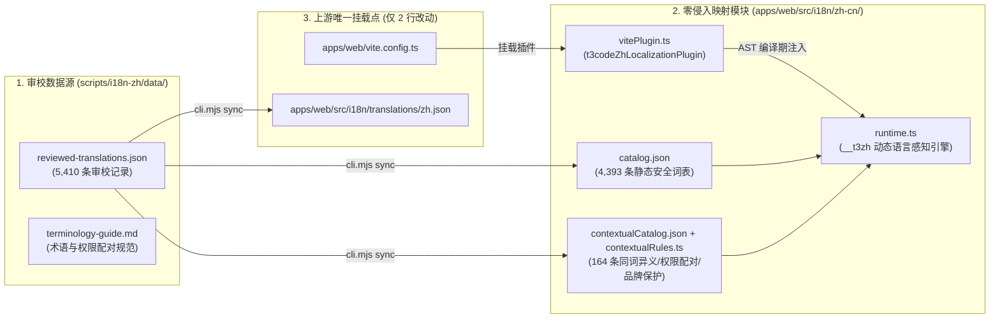

# T3 Code 零侵入中文映射与无痛 Rebase 架构 (`i18n-zh`)

本模块专为 `HandleCoding/t3code` Fork 设计，目标是在**不侵入修改任何业务 UI 组件源码（`.tsx` / `.ts`）**的前提下，提供完整、精准、支持上下文消歧的简体中文本地化能力，并确保在跟进上游 `pingdotgg/t3code` 迭代时实现**零冲突 `git rebase`**。

---

## 一、 核心架构设计



### 为什么这套架构能做到“优雅且无痛 Rebase”？

1. **零业务组件侵入（Zero Component Touch）**：
   - 传统汉化 Fork 直接修改数百个 `.tsx` 组件文件，上游一旦重构组件就会产生大量 Git 冲突。
   - 本架构对上游源码的修改**仅限 `apps/web/vite.config.ts` 中的 2 行插件挂载**（以及 `apps/web/src/i18n/translations/zh.json` 词条对齐），所有 1,375 个前端业务源码文件保持 100% 原生状态。
2. **编译期 AST 精准识别 + 运行时上下文消歧（Compile-Time AST + Runtime Context）**：
   - `t3codeZhLocalizationPlugin` 在 `@vitejs/plugin-react` 将 JSX 编译为标准 `_jsx(type, { children, label, title, description, ... })` 后执行 `enforce: "post"` 转换。
   - 仅转换**静态 UI 属性字面量**（`children`、`label`、`title`、`description`、`placeholder`、`tooltip`、`hint`、`heading`、`message`、`emptyMessage`、`aria-label`、`aria-description`、`resetLabel`、`/settings/*` 及 `*_LABELS` / `runtimeModeConfig` 字典值），**绝不触碰运行时聊天内容、代码编辑器、终端输出、对象 Key 或 `===` 逻辑判断**。
   - 注入调用包含源文件与属性上下文：`__t3zh("Code", "DiffPanel.tsx:label")`，从而在运行时精准区分：
     - 普通代码标签 `"Code"` → `"代码"`，而产品品牌 `"T3 Code"` / `"Claude Code"` / `"VS Code"` → **严格保留英文原名**。
     - 权限模式 `"Auto"` → `"自动"`（成对匹配说明 `"受支持的模型服务会自动批准常规操作，其余情况仍需询问。"`），而配置枚举值 `"auto"` → **保持原样**。
     - 音效选项 `"Click"` 在 `snap-shot` 设置中 → `"快门声"`，在普通交互中 → `"点击"`。
3. **100% 兼容上游自动化测试**：
   - 插件在 Vitest 测试环境（`process.env.VITEST` 或 `mode === "test"`）下默认自动旁路（除非显式设置 `T3CODE_I18N_TEST=1`），因此上游所有断言英文文案的单元测试和浏览器测试无需任何修改即可 100% 通过。
4. **原生支持动态语言切换**：
   - `__t3zh()` 实时联动 T3 Code 原生的 `Settings → General → Language`（`getI18nSnapshot().locale`）。当用户在设置中切换 `中文` 与 `English` 时，界面即时切换。

---

## 二、 目录结构

| 路径 | 职责说明 |
| :--- | :--- |
| `apps/web/src/i18n/zh-cn/vitePlugin.ts` | Vite 后置 AST 转换插件 `t3codeZhLocalizationPlugin()`（零外部依赖，直接使用 Vite 内置 ESTree 解析器） |
| `apps/web/src/i18n/zh-cn/runtime.ts` | 运行时翻译函数 `__t3zh(text, ctxKey)`，联动 `getI18nSnapshot()` 与上下文规则 |
| `apps/web/src/i18n/zh-cn/contextualRules.ts` | 品牌保护集合、五组权限标签与说明强绑定映射、同词异义（`Code`/`Auto`/`Click` 等）按文件与属性消歧逻辑 |
| `apps/web/src/i18n/zh-cn/catalog.json` | 由 `sync` 编译生成的 4,393 条静态安全 UI 词典 |
| `apps/web/src/i18n/zh-cn/contextualCatalog.json` | 由 `sync` 编译生成的 164 条上下文消歧词典 |
| `scripts/i18n-zh/cli.mjs` | 词表编译同步、状态校验、上游增量扫描 CLI 工具 |
| `scripts/i18n-zh/data/reviewed-translations.json` | 完整 5,410 条审校主数据源（含 `translate` / `keep` / `contextual` / `exclude` 决策与理由） |
| `scripts/i18n-zh/data/terminology-guide.md` | 完整术语规范、权限配对表与消歧指南 |

---

## 三、 日常跟进上游 Rebase 工作流

当上游 `pingdotgg/t3code` 发布新版本或合入新提交时，只需执行以下三步：

```bash
# 1. 拉取上游最新代码并直接 rebase（因未改动业务组件，几乎永远零冲突）
git fetch upstream
git rebase upstream/main

# 2. 扫描上游新增的未翻译 UI 词条（生成 scripts/i18n-zh/data/untranslated-delta.json）
node scripts/i18n-zh/cli.mjs audit-upstream

# 3. 补充新增词条至 reviewed-translations.json 后，一键同步并运行校验测试
node scripts/i18n-zh/cli.mjs sync
node scripts/i18n-zh/cli.mjs status
node scripts/i18n-zh/cli.mjs test
```
